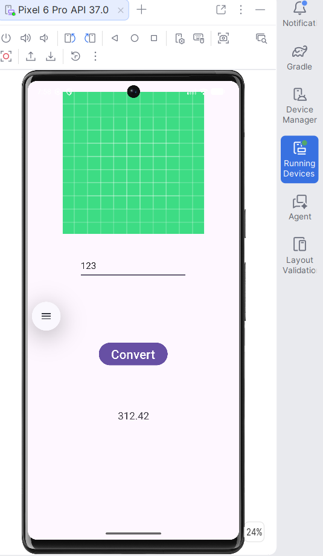

# Inches to Centimeters Converter



A simple, lightweight Android app written in **Kotlin** that converts inches to centimeters. Enter a value, tap **Convert**, and the result appears instantly.


## Features

- Converts inches to centimeters using the exact factor `1 in = 2.54 cm`
- One-tap conversion with a clean Material-themed UI
- Input validation: if the field is empty, the app shows a "Please enter a number" message instead of crashing
- Single-screen `ConstraintLayout` UI, with no extra dependencies beyond AndroidX and Material Components

## How It Works

1. Type a number of inches into the input field.
2. Tap **Convert**.
3. The equivalent length in centimeters is shown below the button.

Example: `123` inches → `312.42` cm

The conversion lives in `MainActivity.kt`: the button's click listener reads the input, multiplies it by `2.54`, and writes the result to a `TextView`.

## Tech Stack

| Component | Details |
|-----------|---------|
| Language | Kotlin |
| UI | XML layouts, `ConstraintLayout`, Material Components |
| Build system | Gradle (Kotlin DSL) with a version catalog |
| Android Gradle Plugin | 9.2.1 |
| Gradle | 9.4.1 (via wrapper) |
| Min SDK | 24 (Android 7.0) |
| Target / Compile SDK | 36 |
| Java compatibility | 11 |

## Project Structure

```
InchesToCentimeters/
├── app/
│   ├── build.gradle.kts
│   └── src/
│       ├── main/
│       │   ├── java/com/example/inchestocentimeters/MainActivity.kt
│       │   ├── res/layout/activity_main.xml
│       │   ├── res/values/        # strings, colors, themes
│       │   └── AndroidManifest.xml
│       ├── test/                  # local unit tests
│       └── androidTest/           # instrumented tests
├── gradle/
│   ├── libs.versions.toml         # dependency version catalog
│   └── wrapper/
├── screenshots/
│   └── app-screenshot.png
├── build.gradle.kts
├── settings.gradle.kts
└── README.md
```

## Getting Started

### Prerequisites

- [Android Studio](https://developer.android.com/studio) (a recent version that supports Android Gradle Plugin 9.x)
- JDK 17 or newer (the one bundled with Android Studio works)
- An Android emulator or a physical device running Android 7.0 (API 24) or higher

### Run the App

1. Clone the repository:
   ```bash
   git clone https://github.com/<your-username>/inches-to-centimeters-android.git
   ```
2. Open the project folder in Android Studio.
3. Let Gradle sync finish.
4. Select an emulator or connected device and click **Run ▶**.

### Build from the Command Line

```bash
# Linux / macOS
./gradlew assembleDebug

# Windows
gradlew.bat assembleDebug
```

The debug APK is generated at `app/build/outputs/apk/debug/`.

### Run Tests

```bash
./gradlew test                    # local unit tests
./gradlew connectedAndroidTest    # instrumented tests (device/emulator required)
```

## Known Limitations and Ideas for Improvement

- The input field currently accepts whole numbers only (`inputType="number"`); switching to `numberDecimal` would allow values like `5.5`.
- Add centimeters → inches (reverse) conversion.
- Format the output to a fixed number of decimal places.
- Add unit tests for the conversion logic.

## Contributing

Contributions, issues, and feature requests are welcome. Feel free to open an issue or submit a pull request.

## License

This project is open source. Add a `LICENSE` file (for example, [MIT](https://choosealicense.com/licenses/mit/)) to define the terms of use.
